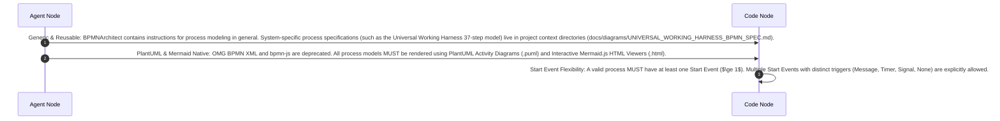
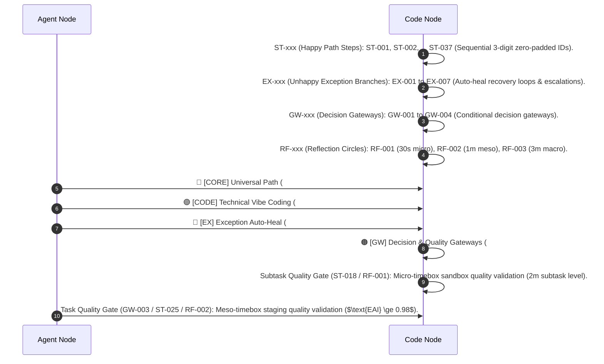
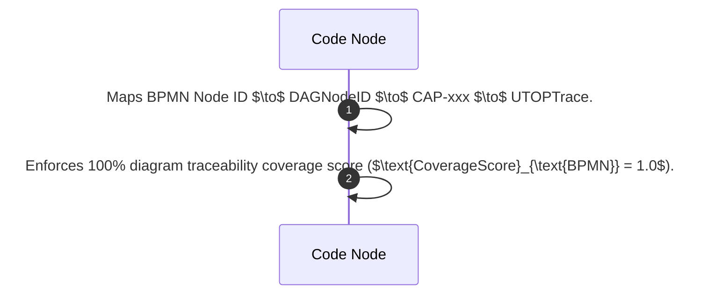

# Sequence Diagrams

> Auto-generated by UCBDDManager SequenceGenerator.
> Source hash: 19afe8c05b3296fd4fd53b43a241682b8b4479bab2c5b4f9b1003c254b2f6156

### UC-001: 1. Overview & Generic Design Principles

### UC-002: 2. Standard Taxonomy & Rules

### UC-003: 4. UTOP Traceability Integration

