# 53.REF.07: 37-Step Technical Vibe Coding Process

> **Protocol**: `TECHNICAL` | **Version**: `2.0.0` | **Skill Engine**: `BPMNArchitect`

## 1. Process Verification Proof Summary (Deterministic P=1)

| Gate | Check | Result | Metric |
|---|---|---|---|
| Semantic Integrity | Reachability & Dead-End Elimination | PASS | 47 nodes, 50 flows, 0 dead-ends |
| Layout Geometry | Shape Collisions & Box Cuts | PASS | 0 collisions, 0 cuts |
| Arrow Disjointness | Segment Overlap Audit | PASS | 0 overlaps across 108 segments |

## 2. Mermaid Process Topology

```mermaid
flowchart TD
    classDef human fill:#fff3e0,stroke:#f57c00,stroke-width:2px,color:#0f172a;
    classDef code fill:#e1f5fe,stroke:#0288d1,stroke-width:2px,color:#0f172a;
    classDef agent fill:#f3e5f5,stroke:#7b1fa2,stroke-width:2px,color:#0f172a;
    classDef ex fill:#ffebee,stroke:#d32f2f,stroke-width:2px,color:#7f1d1d;
    classDef gw fill:#fffde7,stroke:#fbc02d,stroke-width:2px,color:#0f172a;

    START(["Process Initiated"]):::human
    END(["Process Completed"]):::code
    subgraph P1["Phase 1: Intake & Register"]
        ST_001["ST-001: Message Inquiry Intake"]:::human
        ST_002["ST-002: Intent Detection & Task Registry"]:::code
        ST_003["ST-003: SMART Syntax & BMC Binding"]:::code
        ST_004["ST-004: WSJF Strategic Prioritization"]:::code
        ST_005["ST-005: Graph & DB Registration"]:::code
    end
    subgraph P2["Phase 2: Plan & Assign / Sign-Off"]
        ST_006["ST-006: User Story Ingestion"]:::agent
        ST_007["ST-007: UC 3.0 & BDD Specification"]:::agent
        ST_008["ST-008: Subtask Decomposition"]:::agent
        ST_009["ST-009: Kahn DAG Wave Calculation"]:::code
        ST_010["ST-010: Write-Set Sibling Check"]:::code
        ST_011["ST-011: Kahn MergePoint Insertion"]:::code
    end
    subgraph P3["Phase 3: Authorize"]
        ST_012["ST-012: PolicyPack Boundary Audit"]:::code
        ST_013["ST-013: Capability Grant Issuance"]:::code
    end
    subgraph P4["Phase 4: Parallel Execute"]
        ST_014["ST-014: Git Worktree Provisioning"]:::code
        ST_015["ST-015: Dynamic Parallel Fan-Out"]:::code
        ST_016["ST-016: Technical Code Execution"]:::agent
        ST_017["ST-017: Pomodoro Focus Enforcement"]:::code
        ST_018["ST-018: Subtask Micro-Reflection (RF-001)"]:::agent
        ST_019["ST-019: Local Sandbox Unit Testing"]:::code
        ST_020["ST-020: Stream Barrier Synchronization"]:::code
    end
    subgraph P5["Phase 5: Validate & Review"]
        ST_021["ST-021: Static Analysis & Ruff Linting"]:::code
        ST_022["ST-022: SAST Security & Secret Scan"]:::code
        ST_023["ST-023: Gherkin BDD & Automated Test Runner"]:::code
        ST_024["ST-024: 15 QualityGate Reviewers Swarm"]:::code
        ST_025["ST-025: LLM-as-a-Judge EAI Scoring"]:::agent
        ST_026["ST-026: Task Meso-Reflection (RF-002)"]:::agent
        ST_027["ST-027: Compile walkthrough.md Proof"]:::agent
    end
    subgraph P6["Phase 6: Approve & Integrate"]
        ST_028["ST-028: Separation of Duties Check"]:::code
        ST_029["ST-029: Git Fast-Forward Merge"]:::code
        ST_030["ST-030: Worktree Cleanup"]:::code
        ST_031["ST-031: CI/CD Build Canary Trigger"]:::code
    end
    subgraph P7["Phase 7: Close & Learn"]
        ST_032["ST-032: SD-008 Post-Completion Hooks"]:::code
        ST_033["ST-033: Documentation Publishing"]:::code
        ST_034["ST-034: Task State Done Transition"]:::code
        ST_035["ST-035: LangFuse Telemetry Audit"]:::code
        ST_036["ST-036: Sprint Macro-Reflection (RF-003)"]:::agent
        ST_037["ST-037: EBQC Distillation & Promotion"]:::agent
    end
    GW_001{"GW-001: Dual Architecture Sign-Off"}:::gw
    GW_002{"GW-002: Minimal-HITL Authorization"}:::gw
    GW_003{"GW-003: 3-Way AST Merge Barrier"}:::gw
    GW_004{"GW-004: QualityGate Verification"}:::gw
    EX_001["EX-001: Auto-Heal (ARCH_REJECTED)"]:::ex
    EX_002["EX-002: Auto-Heal (HIGH_RISK_HITL)"]:::ex
    EX_003["EX-003: Auto-Heal (AST_CONFLICT)"]:::ex
    EX_004["EX-004: Auto-Heal (QUALITY_GATE_FAIL)"]:::ex

    START --> ST_001
    ST_001 --> ST_002
    ST_002 --> ST_003
    ST_003 --> ST_004
    ST_004 --> ST_005
    ST_005 --> ST_006
    ST_006 --> ST_007
    ST_007 --> ST_008
    ST_008 --> ST_009
    ST_009 --> ST_010
    ST_010 --> GW_001
    ST_011 --> ST_012
    ST_012 --> GW_002
    ST_013 --> ST_014
    ST_014 --> ST_015
    ST_015 --> ST_016
    ST_016 --> ST_017
    ST_017 --> ST_018
    ST_018 --> ST_019
    ST_019 --> GW_003
    ST_020 --> ST_021
    ST_021 --> ST_022
    ST_022 --> ST_023
    ST_023 --> ST_024
    ST_024 --> ST_025
    ST_025 --> ST_026
    ST_026 --> GW_004
    ST_027 --> ST_028
    ST_028 --> ST_029
    ST_029 --> ST_030
    ST_030 --> ST_031
    ST_031 --> ST_032
    ST_032 --> ST_033
    ST_033 --> ST_034
    ST_034 --> ST_035
    ST_035 --> ST_036
    ST_036 --> ST_037
    GW_001 -- "Pass" --> ST_011
    GW_001 -- "ARCH_REJECTED" --> EX_001
    GW_002 -- "Pass" --> ST_013
    GW_002 -- "HIGH_RISK_HITL" --> EX_002
    GW_003 -- "Pass" --> ST_020
    GW_003 -- "AST_CONFLICT" --> EX_003
    GW_004 -- "Pass" --> ST_027
    GW_004 -- "QUALITY_GATE_FAIL" --> EX_004
    EX_001 -- "Retry -> ST-006" --> ST_006
    EX_002 -- "Retry -> ST-013" --> ST_013
    EX_003 -- "Retry -> ST-016" --> ST_016
    EX_004 -- "Retry -> ST-016" --> ST_016
    ST_037 --> END
```

## 3. Step-by-Step Execution Matrix

| Step ID | Phase | Title | Node Type | Swimlane | Pomodoro | Rule / Reference |
|:---:|:---:|---|---|:---:|:---:|---|
| **ST-001** | P1: Intake & Register | Message Inquiry Intake | `HumanNode` | Human Node | 2m | 53.REF.07 Intake |
| **ST-002** | P1: Intake & Register | Intent Detection & Task Registry | `CodeNode` | Code Node | 2m | DocOrg SSOT |
| **ST-003** | P1: Intake & Register | SMART Syntax & BMC Binding | `CodeNode` | Code Node | 2m | GW-GENESIS-01 / 7H |
| **ST-004** | P1: Intake & Register | WSJF Strategic Prioritization | `CodeNode` | Code Node | 2m | CoD / Duration |
| **ST-005** | P1: Intake & Register | Graph & DB Registration | `CodeNode` | Code Node | 2m | KuzuDB + SQLite |
| **ST-006** | P2: Plan & Assign / Sign-Off | User Story Ingestion | `AgentNode` | Agent Node Swarm | 2m | US-xxx + Context Swarm |
| **ST-007** | P2: Plan & Assign / Sign-Off | UC 3.0 & BDD Specification | `AgentNode` | Agent Node Swarm | 2m | GW-UTOP-01 (17-Artifact) |
| **ST-008** | P2: Plan & Assign / Sign-Off | Subtask Decomposition | `AgentNode` | Agent Node Swarm | 2m | Atomic WBS <= 5m |
| **ST-009** | P2: Plan & Assign / Sign-Off | Kahn DAG Wave Calculation | `CodeNode` | Code Node | 2m | Zero-Indegree W_k |
| **ST-010** | P2: Plan & Assign / Sign-Off | Write-Set Sibling Check | `CodeNode` | Code Node | 2m | Disjoint AST Write-Sets |
| **ST-011** | P2: Plan & Assign / Sign-Off | Kahn MergePoint Insertion | `CodeNode` | Code Node | 2m | 53.REF.69 Sprint Sync |
| **ST-012** | P3: Authorize | PolicyPack Boundary Audit | `CodeNode` | Code Node | 2m | authorization_matrix.yaml |
| **ST-013** | P3: Authorize | Capability Grant Issuance | `CodeNode` | Code Node | 2m | Scoped GRANT-XXX |
| **ST-014** | P4: Parallel Execute | Git Worktree Provisioning | `CodeNode` | Code Node | 2m | .worktrees/feat-* |
| **ST-015** | P4: Parallel Execute | Dynamic Parallel Fan-Out | `CodeNode` | Code Node | 2m | |W_k| <= 20 |
| **ST-016** | P4: Parallel Execute | Technical Code Execution | `AgentNode` | Agent Node Swarm | 2m | Implements: UC/FR/TC |
| **ST-017** | P4: Parallel Execute | Pomodoro Focus Enforcement | `CodeNode` | Code Node | 2m | GW-TIMEBOX-01 (2m) |
| **ST-018** | P4: Parallel Execute | Subtask Micro-Reflection (RF-001) | `AgentNode` | Agent Node Swarm | 2m | 30s Recalibration |
| **ST-019** | P4: Parallel Execute | Local Sandbox Unit Testing | `CodeNode` | Code Node | 2m | Pytest Sandbox |
| **ST-020** | P4: Parallel Execute | Stream Barrier Synchronization | `CodeNode` | Code Node | 2m | MergePoint Sync |
| **ST-021** | P5: Validate & Review | Static Analysis & Ruff Linting | `CodeNode` | Code Node | 2m | Ruff / AST Lint |
| **ST-022** | P5: Validate & Review | SAST Security & Secret Scan | `CodeNode` | Code Node | 2m | Bandit / Secret Guard |
| **ST-023** | P5: Validate & Review | Gherkin BDD & Automated Test Runner | `CodeNode` | Code Node | 2m | MinTC vs _data.json |
| **ST-024** | P5: Validate & Review | 15 QualityGate Reviewers Swarm | `CodeNode` | Code Node | 2m | GW-QG-01 Review |
| **ST-025** | P5: Validate & Review | LLM-as-a-Judge EAI Scoring | `AgentNode` | Agent Node Swarm | 2m | EAI >= 0.98 |
| **ST-026** | P5: Validate & Review | Task Meso-Reflection (RF-002) | `AgentNode` | Agent Node Swarm | 2m | 1m Reflection |
| **ST-027** | P5: Validate & Review | Compile walkthrough.md Proof | `AgentNode` | Agent Node Swarm | 2m | Empirical Proof + Sealing |
| **ST-028** | P6: Approve & Integrate | Separation of Duties Check | `CodeNode` | Code Node | 2m | GW-SOD-01 |
| **ST-029** | P6: Approve & Integrate | Git Fast-Forward Merge | `CodeNode` | Code Node | 2m | GW-GIT-BRANCH-01 |
| **ST-030** | P6: Approve & Integrate | Worktree Cleanup | `CodeNode` | Code Node | 2m | Prune Ephemeral Branch |
| **ST-031** | P6: Approve & Integrate | CI/CD Build Canary Trigger | `CodeNode` | Code Node | 2m | GW-DEPLOY-07 |
| **ST-032** | P7: Close & Learn | SD-008 Post-Completion Hooks | `CodeNode` | Code Node | 2m | DocOrg MECE Hygiene |
| **ST-033** | P7: Close & Learn | Documentation Publishing | `CodeNode` | Code Node | 2m | Catalog & Spec Sync |
| **ST-034** | P7: Close & Learn | Task State Done Transition | `CodeNode` | Code Node | 2m | 53.REF.69 Archive |
| **ST-035** | P7: Close & Learn | LangFuse Telemetry Audit | `CodeNode` | Code Node | 2m | Coverage = 1.0 |
| **ST-036** | P7: Close & Learn | Sprint Macro-Reflection (RF-003) | `AgentNode` | Agent Node Swarm | 2m | 3m Macro Retro |
| **ST-037** | P7: Close & Learn | EBQC Distillation & Promotion | `AgentNode` | Agent Node Swarm | 2m | 4-Stage Crystallization |

## 4. Decision Gateways & Dead-End Eliminated Exception Loops

| ID | Type | Title / Trigger | Condition / Error | Pass / Target | Recovery / Fallback |
|:---:|:---:|---|---|---|---|
| **GW-001** | Gateway (XOR) | Dual Architecture Sign-Off | `approved == True` | `ST-011` | `EX-001` |
| **GW-002** | Gateway (XOR) | Minimal-HITL Authorization | `eai >= 0.98 or approved` | `ST-013` | `EX-002` |
| **GW-003** | Gateway (XOR) | 3-Way AST Merge Barrier | `conflicts == 0` | `ST-020` | `EX-003` |
| **GW-004** | Gateway (XOR) | QualityGate Verification | `eai >= 0.98 and tests_green` | `ST-027` | `EX-004` |
| **EX-001** | Exception Loop | Trigger from `GW-001` | `ARCH_REJECTED` | `ST-006` | Auto-Heal (max 3 retries) |
| **EX-002** | Exception Loop | Trigger from `GW-002` | `HIGH_RISK_HITL` | `ST-013` | Auto-Heal (max 3 retries) |
| **EX-003** | Exception Loop | Trigger from `GW-003` | `AST_CONFLICT` | `ST-016` | Auto-Heal (max 3 retries) |
| **EX-004** | Exception Loop | Trigger from `GW-004` | `QUALITY_GATE_FAIL` | `ST-016` | Auto-Heal (max 3 retries) |
