# 53.REF.08: 18-Step Universal Vibe Working Process [CORE]

> **Protocol**: `CORE` | **Version**: `3.0.0` | **Skill Engine**: `BPMNArchitect`

## 1. Process Verification Proof Summary (Deterministic P=1)

| Gate | Check | Result | Metric |
|---|---|---|---|
| Semantic Integrity | Reachability & Dead-End Elimination | PASS | 26 nodes, 28 flows, 0 dead-ends |
| Layout Geometry | Shape Collisions & Box Cuts | PASS | 0 collisions, 0 cuts |
| Arrow Disjointness | Segment Overlap Audit | PASS | 0 overlaps across 77 segments |

## 2. Mermaid Process Topology

```mermaid
flowchart TD
    classDef human fill:#fff3e0,stroke:#f57c00,stroke-width:2px,color:#0f172a;
    classDef code fill:#e1f5fe,stroke:#0288d1,stroke-width:2px,color:#0f172a;
    classDef agent fill:#f3e5f5,stroke:#7b1fa2,stroke-width:2px,color:#0f172a;
    classDef ex fill:#ffebee,stroke:#d32f2f,stroke-width:2px,color:#7f1d1d;
    classDef gw fill:#fffde7,stroke:#fbc02d,stroke-width:2px,color:#0f172a;

    START(["Process Initiated"]):::human
    END(["Process Completed"]):::code
    subgraph P1["Phase 1: Intake & Registration"]
        ST_001["ST-001: Message Inquiry Intake"]:::human
        ST_002["ST-002: Task Registration & SSOT Intake"]:::code
        ST_003["ST-003: Goal & Pomodoro Budget"]:::code
    end
    subgraph P2["Phase 2: Plan & Sign-Off (Outline & Rubrics)"]
        ST_004["ST-004: Plan & Outline Decomposition"]:::agent
        ST_005["ST-005: Kahn DAG Wave Calculation"]:::code
        ST_006["ST-006: MergePoint Barrier Insertion"]:::code
    end
    subgraph P3["Phase 3: Authorize (Minimal-HITL)"]
        ST_007["ST-007: Grant Issuance & Path Guard"]:::code
    end
    subgraph P4["Phase 4: Parallel Execution"]
        ST_008["ST-008: Dynamic Fan-Out Execution"]:::agent
        ST_009["ST-009: Pomodoro Focus Enforcement"]:::code
        ST_010["ST-010: Subtask Micro-Reflection (RF-001)"]:::agent
        ST_011["ST-011: MergePoint Barrier Sync"]:::code
    end
    subgraph P5["Phase 5: Validate & Review"]
        ST_012["ST-012: Document Depth & Rule Audit"]:::code
        ST_013["ST-013: Mandatory EBQC Quality Gate"]:::code
        ST_014["ST-014: Task Meso-Reflection (RF-002)"]:::agent
        ST_015["ST-015: Compile walkthrough.md Proof"]:::agent
    end
    subgraph P6["Phase 6: Approve & Integrate"]
        ST_016["ST-016: Separation of Duties Check"]:::code
        ST_017["ST-017: Commit MECE Zone & Git Sync"]:::code
    end
    subgraph P7["Phase 7: Close, Distill & Learn"]
        ST_018["ST-018: Close, Macro-Reflection (RF-003) & Distill"]:::agent
    end
    GW_001{"GW-001: Rubric & Outline Baseline"}:::gw
    GW_002{"GW-002: Minimal-HITL Scope Gate"}:::gw
    GW_003{"GW-003: QualityGate Pass (EAI >= 0.98)"}:::gw
    EX_001["EX-001: Auto-Heal (RUBRIC_MISSING)"]:::ex
    EX_002["EX-002: Auto-Heal (HIGH_RISK_HITL)"]:::ex
    EX_003["EX-003: Auto-Heal (QUALITY_GATE_FAIL)"]:::ex

    START --> ST_001
    ST_001 --> ST_002
    ST_002 --> ST_003
    ST_003 --> ST_004
    ST_004 --> GW_001
    ST_005 --> ST_006
    ST_006 --> GW_002
    ST_007 --> ST_008
    ST_008 --> ST_009
    ST_009 --> ST_010
    ST_010 --> ST_011
    ST_011 --> ST_012
    ST_012 --> ST_013
    ST_013 --> ST_014
    ST_014 --> GW_003
    ST_015 --> ST_016
    ST_016 --> ST_017
    ST_017 --> ST_018
    GW_001 -- "Pass" --> ST_005
    GW_001 -- "RUBRIC_MISSING" --> EX_001
    GW_002 -- "Pass" --> ST_007
    GW_002 -- "HIGH_RISK_HITL" --> EX_002
    GW_003 -- "Pass" --> ST_015
    GW_003 -- "QUALITY_GATE_FAIL" --> EX_003
    EX_001 -- "Retry -> ST-004" --> ST_004
    EX_002 -- "Retry -> ST-007" --> ST_007
    EX_003 -- "Retry -> ST-008" --> ST_008
    ST_018 --> END
```

## 3. Step-by-Step Execution Matrix

| Step ID | Phase | Title | Node Type | Swimlane | Pomodoro | Rule / Reference |
|:---:|:---:|---|---|:---:|:---:|---|
| **ST-001** | P1: Intake & Registration | Message Inquiry Intake | `HumanNode` | Human Node | 2m | 53.REF.08 Intake |
| **ST-002** | P1: Intake & Registration | Task Registration & SSOT Intake | `CodeNode` | Code Node | 2m | DocOrg Intake |
| **ST-003** | P1: Intake & Registration | Goal & Pomodoro Budget | `CodeNode` | Code Node | 2m | SMART + 15m Sprint |
| **ST-004** | P2: Plan & Sign-Off (Outline & Rubrics) | Plan & Outline Decomposition | `AgentNode` | Agent Node Swarm | 2m | TOC + 4-Block Goal + DoD |
| **ST-005** | P2: Plan & Sign-Off (Outline & Rubrics) | Kahn DAG Wave Calculation | `CodeNode` | Code Node | 2m | Zero-Indegree Waves |
| **ST-006** | P2: Plan & Sign-Off (Outline & Rubrics) | MergePoint Barrier Insertion | `CodeNode` | Code Node | 2m | Kahn Barrier |
| **ST-007** | P3: Authorize (Minimal-HITL) | Grant Issuance & Path Guard | `CodeNode` | Code Node | 2m | GRANT-XXX / MECE Zone |
| **ST-008** | P4: Parallel Execution | Dynamic Fan-Out Execution | `AgentNode` | Agent Node Swarm | 2m | Depth <= 2 Synthesis |
| **ST-009** | P4: Parallel Execution | Pomodoro Focus Enforcement | `CodeNode` | Code Node | 2m | GW-TIMEBOX-01 (2m/5m) |
| **ST-010** | P4: Parallel Execution | Subtask Micro-Reflection (RF-001) | `AgentNode` | Agent Node Swarm | 2m | 30s Recalibration |
| **ST-011** | P4: Parallel Execution | MergePoint Barrier Sync | `CodeNode` | Code Node | 2m | Draft Consolidation |
| **ST-012** | P5: Validate & Review | Document Depth & Rule Audit | `CodeNode` | Code Node | 2m | MECE Depth <= 2 |
| **ST-013** | P5: Validate & Review | Mandatory EBQC Quality Gate | `CodeNode` | Code Node | 2m | EAI >= 0.98 |
| **ST-014** | P5: Validate & Review | Task Meso-Reflection (RF-002) | `AgentNode` | Agent Node Swarm | 2m | 1m Reflection |
| **ST-015** | P5: Validate & Review | Compile walkthrough.md Proof | `AgentNode` | Agent Node Swarm | 2m | 1:1 DoD Matrix |
| **ST-016** | P6: Approve & Integrate | Separation of Duties Check | `CodeNode` | Code Node | 2m | GW-SOD-01 |
| **ST-017** | P6: Approve & Integrate | Commit MECE Zone & Git Sync | `CodeNode` | Code Node | 2m | 10/20/30 Zone Commit |
| **ST-018** | P7: Close, Distill & Learn | Close, Macro-Reflection (RF-003) & Distill | `AgentNode` | Agent Node Swarm | 2m | WeKnora + hot.md <= 500w |

## 4. Decision Gateways & Dead-End Eliminated Exception Loops

| ID | Type | Title / Trigger | Condition / Error | Pass / Target | Recovery / Fallback |
|:---:|:---:|---|---|---|---|
| **GW-001** | Gateway (XOR) | Rubric & Outline Baseline | `outline_and_dod_ready` | `ST-005` | `EX-001` |
| **GW-002** | Gateway (XOR) | Minimal-HITL Scope Gate | `tier <= 1 and scope_ok` | `ST-007` | `EX-002` |
| **GW-003** | Gateway (XOR) | QualityGate Pass (EAI >= 0.98) | `eai >= 0.98 and dod_pass` | `ST-015` | `EX-003` |
| **EX-001** | Exception Loop | Trigger from `GW-001` | `RUBRIC_MISSING` | `ST-004` | Auto-Heal (max 3 retries) |
| **EX-002** | Exception Loop | Trigger from `GW-002` | `HIGH_RISK_HITL` | `ST-007` | Auto-Heal (max 3 retries) |
| **EX-003** | Exception Loop | Trigger from `GW-003` | `QUALITY_GATE_FAIL` | `ST-008` | Auto-Heal (max 3 retries) |
