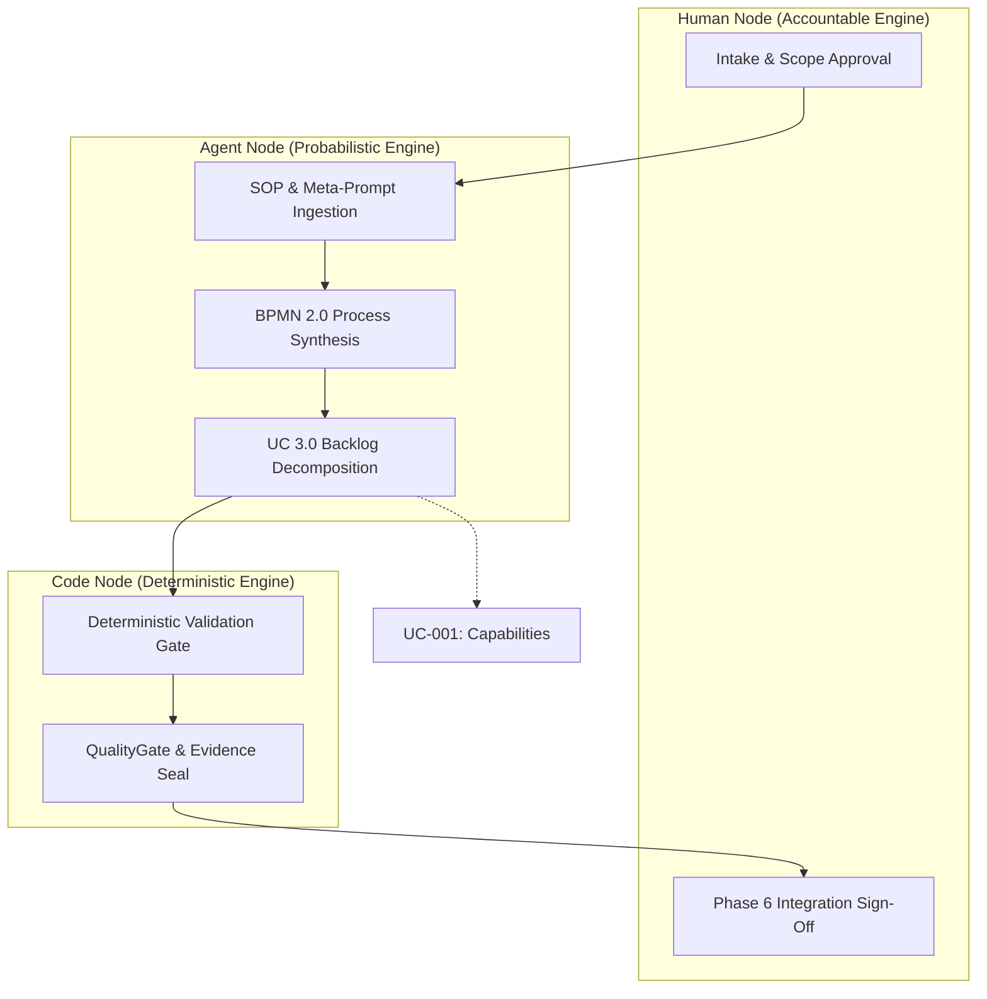
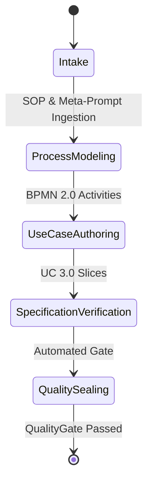

# BPMN 2.0 Process Workflows & FSM

> Auto-generated by UCBDDManager BPMNGenerator.
> Upstream Hierarchy: SOP & Meta-Prompts ──► BPMN 2.0 ──► UC 3.0
> Source hash: 52f06c09ac9cc87195df980475c8b554d5e11078efe5cebc119d705bba70f1e3

## 3-Pillar Swimlane Process Flow

## State Lifecycle & Invariants

